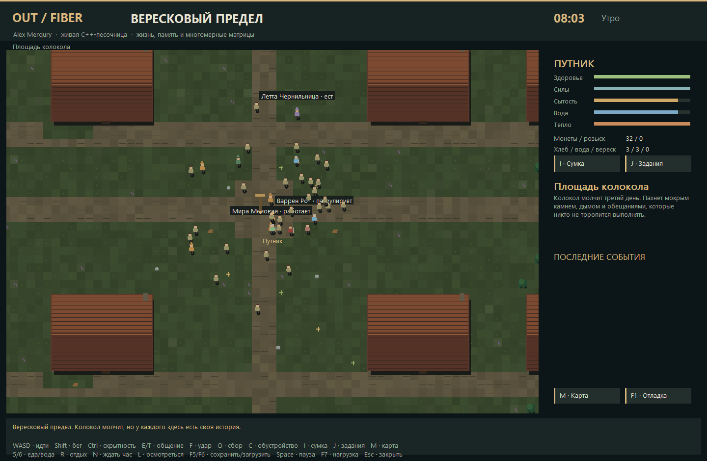
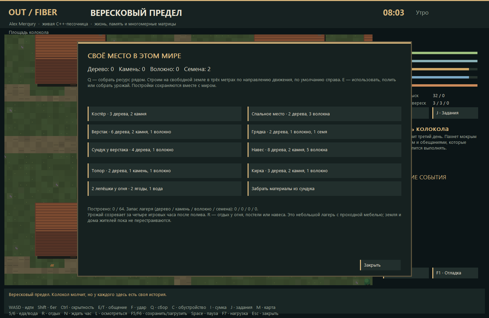

# OUT FIBER / Heather Reach — Tales 0.2

**Native C++17 RPG sandbox with a slower daily life and a multidimensional low-precision behavior benchmark.**
Architecture, concept and product direction: **Alex Merqury**. Rights holder: **Алексей Савельев**.
OpenAI Codex assisted with implementation and verification. [License](../LICENSE) applies to every source file;
source visibility grants neither free project use nor AI training. [По-русски](README.ru.md).



## A place to live

Start with **256 inhabitants**, a close follow-camera and an ordinary morning. The world is
**1,024 × 768 metres**, with eight districts and **128 houses with doors, beds and interiors**.
Residents work, eat, drink, socialize, patrol, forage, pray, recover and sleep. Guards have shifts;
innkeepers keep different hours. People stop moving while occupied instead of perpetually circling.
Threats still exist away from town. Death, witnessed crimes and rumors have consequences.

The supplied Tales story contributes **20 named characters** with original biographies, secrets,
introductory lines, professions and pockets. The four original quests include a letter delivery,
watch evidence, an ethically branching theft/report job and a healer's herbs. Dialogue choices,
friendship, gifts, trade, healing and intimidation affect local relationships. Player inventory,
gold, faction reputation and quest state persist. Dialogue is authored, not generated by an LLM.

A small homestead loop gives exploration a purpose:

- Gather finite local wood, stone, fiber and wild seeds. Depleted nodes recover after 7,200 simulation
  ticks; tools increase appropriate yields. These are ground resource piles, not destructible trees.
- Craft an axe or pick; build a fire, bedroll, workbench, garden, chest or shelter on free land.
  Recipes spend real inventory materials and reject overlapping/invalid placement without charging.
- Water gardens, wait four game hours, harvest berries and seeds; bake two portions of bread from
  two berries and one water near your fire. Use the fire, bedding or shelter to rest and warm up.
- A chest transfers raw materials into a shared camp stockpile. Camp objects, resource stocks,
  crops and stockpile persist in the save. The current limit is **64 nonblocking camp objects**.

This is a small top-down RPG/settlement sandbox in the direction of the publisher's Dwarf Fortress /
Minecraft references. It has no voxel digging, arbitrary terrain rebuilding, multi-level fortress,
production chains, autonomous colony orders, complete scarcity economy or multiplayer. Shared camp
storage is abstract, not a separate container inventory for each chest. Tools do not wear out yet.
Large stress populations reuse the 128 homes; that is a load test, not realistic housing capacity.

## Controls and first steps

| Input | Action |
| --- | --- |
| WASD / Shift / Ctrl / wheel | Walk / sprint / sneak / zoom |
| E / T / L | Use nearby camp/site or talk / talk directly / inspect location |
| Q / C | Gather nearby resource / crafting and camp menu |
| I / J | Inventory / quest journal |
| M or Tab / click on atlas | World overview / set a waypoint without teleporting |
| F / G | Melee strike / toggle blood rendering |
| 5 / 6 / R / N | Eat / drink / rest at shelter or camp / wait one game hour |
| F5 / F6 | Save / load the current world |
| F1 / F2 / F3 / F4 | Debug / policy mode / full 60 Hz AI / labels |
| F7 | Reset population: 256 → 512 → 4,096 → 16,384 → 65,536 |
| Space / F9 / Escape | Pause / fresh 256-person world / close overlay, then exit |

Find colored resource piles close to the arrival square and press Q. C shows recipes and costs.
A camp object is placed three metres in the movement direction, or to the right while standing;
move onto open grass before building. E uses nearby camp objects before NPCs; T talks directly.
Talk to Mira, Varen, Nell or Emery and ask about work. J records quest destinations. The market
sells supplies; L at the docks refills water. One day takes **12 simulation minutes**.
N advances the calendar, needs and crops; it does not simulate every skipped movement/decision.

F5 writes `%LOCALAPPDATA%/OUT_FIBER/HeatherReach-v02.save`. The bounded, checksummed binary save is
**same-build only**, not a portable or authenticated security format. Old layouts and corruption are
rejected. Events, actor memory, relationships, needs, inventory, quests and camp state are saved;
transient blood, UI and log history are not. F9/F7 explicitly replace the current world.



## Actual multidimensional models

| Mechanism | Address axes | Storage / effect |
| --- | --- | --- |
| Branch bank | 3D danger × need × health | 64 cells × up to 3 branches; int4 prototypes, int8 cue gates and residual motor correction |
| Motor table | 4D action group × crowd × fatigue × confidence | Four int8 components for continuous movement response |
| Context table | 5D need × fear × courage × relationship × phase | 1,024 cells, six int4 action biases per cell |
| Daily-life table | 5D hunger × thirst × fatigue × day phase × profession group | 1,024 cells, twelve int4 routine scores |
| Social table | Relationship × alarm × stakes × cue × persona | 2,816 cells; stance and teacher agreement confidence |
| Navigation | Destination × tile y × tile x | Eight shared uint16 global flowfields plus local fields through home doors |

The shared inference bank occupies **23,168 bytes**. Policy memory is **52 bytes per NPC**;
the complete Actor is larger (**216 bytes**), and positions, velocities and collision checks use floats.
The branch teacher is fitted from 48,000 synthetic samples, the life table from 48 per cell and the
social table from 32 per cell. Fitting runs once at process startup and all policy tables then remain
read-only. Runtime experiences update actor state and bounded memory, never the fitted weights.
This is explicit synthetic reference fitting, not an LLM, online learning or proven general intelligence.

Short local peer interaction uses four bounded relationship slots; event memory and observation are
also bounded. Fictional stress, grief, intoxication and unreliable clues affect behavior. These are
game mechanics, not a clinical model or an unrestricted social simulation. A hard action gate,
attention limits, inhibition, action commitment and seeded low-risk branch choice remain in place.

No OUT Guard baked baseline or OUT Motor pose/response dataset is imported. The new procedural
teacher is source; fitted payloads and raw training/trajectory corpora are not published. See
[provenance and authored-story scope](docs/PROVENANCE.md).

## Distance scheduling and honest limits

| Tier | Distance | Movement | Cognition |
| --- | --- | --- | --- |
| Near | < 80 m | 60 Hz | 10 Hz |
| Mid | < 260 m | 15 Hz | 2 Hz |
| Far | Rest of world | 2 Hz | 0.25 Hz |
| Actually sleeping | At home | 1 Hz | 0.5 Hz |

`--no-lod` removes distance tiers; sleep still uses its lower cadence. `--full-ai` forces movement and
cognition at 60 Hz for all actors. Coarse movement sweeps substeps through walls. A persistent pool,
spatial buckets, snapshot reads and serial interaction commit preserve the tested worker-count replay.
Far actors remain approximate; they do not perceive every event. Neighbor candidate budgets are
192 / 64 / 16 for near / mid / far; report counters expose caps. Dense crowds can overlap or stall:
there is no exact contact solver, general physics engine or deformable navigation topology.

The UI caps catch-up work and reports dropped simulation time if overloaded. **Headless CPU timings
are not graphical FPS.** The ordinary `new`/`new[]` counter excludes C/OS allocations; owned memory
excludes stacks, allocator and OS/graphics resources. Replay is verified locally, not guaranteed
bit-for-bit across compilers or CPUs. Synthetic teacher agreement does not establish real-game AI quality.

## Build, test and measure

Windows x64, MSVC C++ tools and Windows SDK:

```bat
OUT_FIBER\tools\build_windows.cmd E:\OUT_FIBER_BUILD
E:\OUT_FIBER_BUILD\OUT_FIBER.exe
E:\OUT_FIBER_BUILD\OUT_FIBER.exe --selftest
E:\OUT_FIBER_BUILD\OUT_FIBER.exe --bench --agents 4096 --workers 8 --ticks 1200 --warmup 120 --seed 41917 --mode exploratory --output report.json
```

Use an x64 Native Tools prompt if automatic VS2022 Community discovery does not match your setup.
Direct build: `/O2 /fp:precise /MT /utf-8 /W4`, C++17. No Unity, browser or downloaded graphics library
is required at runtime. The Win32 frontend uses software pixels and Unicode system fonts.
Alternatively `cmake -S OUT_FIBER -B build/fiber`, then `cmake --build build/fiber --config Release`.
Only the direct Windows build has recorded validation; other platforms/CMake are unverified paths.

`strict`, `overlap`, `exploratory` and `utility` modes share the world; utility is the procedural teacher
baseline. Different decisions produce different workloads, so world timings alone do not prove policy
superiority. `tools/run_benchmarks.ps1 -Executable <path>` writes aggregate v0.2 reports.
`--capture image.png --view game|dialogue|inventory|journal|crafting|world|night` records a real native frame.

Read [v0.2 test and timing results](benchmarks/v02/RESULTS.md), [changelog](CHANGELOG.md),
[source and screenshot hashes](SNAPSHOT.json), or [v0.1 archived measurements](benchmarks/v01/RESULTS.md).
The historical 14-check Lab 0.1 report was not reproduced and is not replaced by these tests.
Support / licensing: [OUT Discord](https://discord.gg/qpa2XdA6uT).
