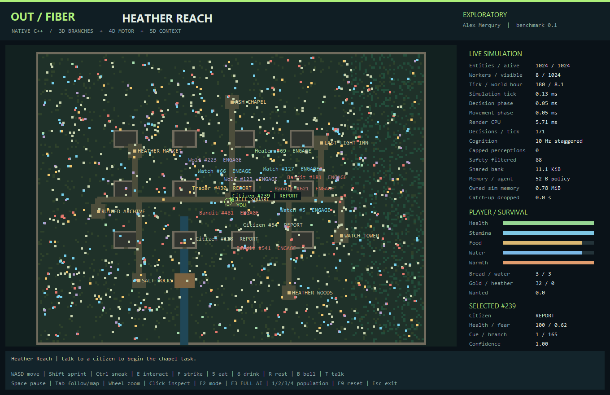

# OUT FIBER / Heather Reach

**A native C++17 RPG survival sandbox and multidimensional low-precision AI benchmark.**
Architecture, concept and product direction: **Alex Merqury**. Rights holder:
**Алексей Савельев**. Implementation assistance: OpenAI Codex.
The [repository LICENSE](../LICENSE) applies. No free project-use or AI-training grant
is created by this benchmark. The publisher's local executable is a separate build.



## What runs

- A continuous top-down world with buildings, doors, forest, river, bridge, market,
  inn, watch tower, docks, chapel, ruins and shared navigation fields.
- Moving citizens, guards, traders, healers, bandits and wolves. NPCs perceive local
  threats, investigate remembered clues, attack, aid allies, retreat and report alarms.
- Per-actor fear, relationships, short event memory, witness/rumor propagation,
  action commitment, inhibition and bounded attention; shared policy storage.
- A controllable player: walking, sprinting, sneaking, stamina, hunger, thirst,
  warmth, food/water inventory, melee attacks, trade, healing, conversation and a
  short gather/deliver quest. Crime is reported when a guard learns of it.
- Interactive population presets: **512 / 4,096 / 16,384 / 65,536**. All actors keep
  simulating. Rendering limits labels, not simulation population.
- Headless timing reports, deterministic replay checks and ordinary C++ heap-allocation
  instrumentation. The maximum supported population is 131,072, not a performance claim.

This is a benchmark sandbox inspired by the supplied Tales/Crystal Field prototypes,
**not a complete Skyrim-scale RPG**. It has no 3D renderer, open-world streaming,
full dialogue/quest catalog, save system, general rigid-body physics or multiplayer.

## Actual multidimensional arrays

| Mechanism | Address axes | Stored values and execution |
| --- | --- | --- |
| Branch field | 3D: danger × need × health, 4 levels each | Up to three branches per cell; 12-bit prototypes in a 16-bit field, int8 cue gates and two-component residual decoder |
| Motor table | 4D: action group × crowd × fatigue × confidence | Four int8 components: speed, steering, avoidance, response; decoded continuous velocity targets |
| Context table | 5D: need × fear × courage × relationship × phase bucket | Six action biases packed as int4 components; actual 1,024-cell address space |
| Navigation | destination × tile y × tile x | Eight uint16 distance fields; shared by all NPCs |

The branch input projection is the identity projection used in the supplied Lab 0.3;
it is not a separately trained matrix. Discrete branch selection is never replaced by
averaging incompatible actions. Residual outputs affect motor response, while positions,
velocities and collision distances remain floating point. This is not an int4 physics
engine, generative language model, transformer or proof of a new universal AI class.

The **11,392-byte** inference bank is generated once at startup from a new explicit
procedural benchmark teacher. It is then read-only. No OUT Guard baked model, OUT Motor
pose/response dataset, authored animation, customer telemetry or training-corpus file
is imported or published. There is no runtime network/model API. See [provenance](docs/PROVENANCE.md).

## Build and launch

Windows x64 with MSVC C++ build tools and a Windows SDK:

```bat
OUT_FIBER\tools\build_windows.cmd E:\OUT_FIBER_BUILD
E:\OUT_FIBER_BUILD\OUT_FIBER.exe
```

Use an x64 Native Tools prompt if the automatic Community-2022 discovery does not
match your Visual Studio installation. The direct build uses `/O2 /fp:precise /MT`.
No Python, Unity, browser runtime or downloaded graphics library is needed to run it.
The Windows frontend uses a DIB software framebuffer and system text rendering.

Alternatively: `cmake -S OUT_FIBER -B build/fiber` followed by
`cmake --build build/fiber --config Release`. CMake and non-Windows builds are provided
as source paths; the recorded validation used the direct Windows MSVC build.

### Controls

| Input | Action |
| --- | --- |
| WASD / Shift / Ctrl | Move / sprint / sneak |
| E / T | Interact at a site or with a nearby NPC / talk |
| F | Melee strike; stamina, cooldown and wall checks apply |
| 5 / 6 / R | Eat / drink / rest at an inn or chapel |
| B | Local alarm; inspect NPC memory and reactions |
| Tab / mouse wheel | Follow player or full map / zoom |
| Click / F4 | Inspect an entity / toggle labels |
| Space / F9 / Escape | Pause / reset current population / exit |
| 1 / 2 / 3 / 4 | Reset to 512 / 4,096 / 16,384 / 65,536 actors |
| F2 / F3 | Change policy mode / enable full 60 Hz cognition |

Talk to a citizen, gather three heather at **HEATHER WOODS**, then interact at
**ASH CHAPEL**. Buy bread at **HEATHER MARKET**, refill water at **SALT DOCKS**.
The clock is accelerated: one world day takes 12 simulation minutes. Death does not
silently reset the benchmark; F9 explicitly starts again.

## Reproducible measurements

```bat
OUT_FIBER.exe --selftest
OUT_FIBER.exe --bench --agents 4096 --workers 8 --ticks 1200 --warmup 120 --seed 41917 --mode exploratory --output report.json
OUT_FIBER.exe --bench --agents 65536 --workers 8 --ticks 180 --warmup 120 --full-ai --output maximum.json
```

Policy modes: `strict`, `overlap`, `exploratory`, `utility`. STRICT uses the base 3D
cell; OVERLAP adds bounded neighbors; EXPLORATORY adds seeded choice only among close,
safe alternatives. UTILITY is the explicit procedural teacher baseline. Every mode
retains the same movement and world implementation; trajectories and workloads can
diverge, so world timings alone are not a controlled proof of policy superiority.

Default simulation is 60 Hz with staggered 10 Hz cognition. `--full-ai` computes
decisions at every 60 Hz tick, without lowering distant-actor AI. A persistent worker
pool, prefix-sum spatial buckets, double-buffered movement and serial interaction
commit preserve replay across tested worker counts. Read [the actual results](benchmarks/RESULTS.md).

### Boundaries that matter

Perception examines at most **192 neighbor candidates** per decision; local movement
avoidance examines a bounded neighborhood. At extreme density this loses observations.
`cappedPerceptions` exposes that limitation, rather than pretending the AI saw everyone.
The world has static tile walls and local sliding, not general navigation/physics.
Dense crowds can overlap or get stuck; they do not have an exact contact solver.

The UI caps catch-up work and reports dropped simulation time when overloaded. Native
headless p95 milliseconds are **not graphical FPS**. An allocation count of zero covers
ordinary `new`/`new[]`, not every operating-system or C allocation. Owned-byte counts
exclude thread stacks, allocator overhead, OS and graphics resources. Seeded replay
was checked on one compiler/platform, not proven portable bit-for-bit across CPUs.

The original historical 14-check Lab 0.1 report was not supplied here and was not
reproduced. This module has its own versioned tests; do not substitute their count for
historical acceptance or claim proven real-world AI quality.
